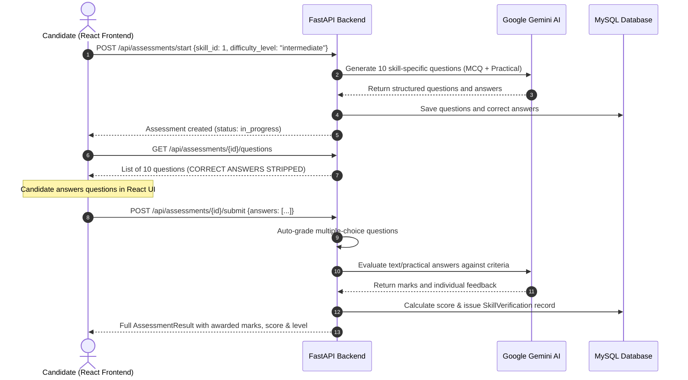

# Thibitisha Skills — Frontend API Integration Guide & Complete Endpoint Inventory

This document is the authoritative integration reference for frontend engineers building the React application for **Thibitisha Skills**. It documents the **actual implementation** of the FastAPI backend service.

---

## 1. Integration Fundamentals

### 1.1 Base URLs and Documentation
- **API Base URL:** `http://localhost:8000` (development) or configured production domain
- **Interactive Swagger UI:** `http://localhost:8000/docs`
- **ReDoc Documentation:** `http://localhost:8000/redoc`
- **OpenAPI JSON Spec:** `http://localhost:8000/openapi.json`
- **Health Check:** `GET /health` or `GET /`

### 1.2 Authentication & Authorization Headers
Protected endpoints require an `Authorization` header containing the JWT bearer token:
```http
Authorization: Bearer <access_token>
```

### 1.3 User Roles & Access Hierarchy
Every authenticated user has one of three string enum roles:
- `job_seeker` — Can upload CVs, select skills, take assessments, manage public/private profile, and apply for jobs.
- `employer` — Can manage employer profile, post jobs, configure required skills & weights, review applicants, and match candidates.
- `admin` — Can manage user accounts (deactivate/activate), create/update/delete skills in the platform catalog, and view system metrics.

### 1.4 Standard Error Response Format
When a request fails, the backend returns standard HTTP status codes (`400`, `401`, `403`, `404`, `409`, `422`, `429`, `503`) with a JSON error payload:
```json
{
  "detail": "Error description message"
}
```
Validation errors (`422 Unprocessable Entity`) contain Pydantic's structured validation error list in `detail`.

---

## 2. Complete Endpoint Inventory (All 59 Endpoints)

| HTTP Method | Endpoint | Feature | Description | Authentication | Allowed Roles | Request Format | Required Fields | Optional Fields | Response | Status Codes |
|---|---|---|---|---|---|---|---|---|---|---|
| `GET` | `/` | System | Health & API metadata | No | Public | None | None | None | `{app, status, documentation, redoc, timestamp}` | 200 |
| `GET` | `/health` | System | Service liveness probe | No | Public | None | None | None | `{status, timestamp}` | 200 |
| `POST` | `/api/auth/register` | Auth | Register a job seeker or employer account | No | Public | JSON | `full_name`, `email`, `password`, `role` | `phone_number`, `location` | `TokenResponse` (`access_token`, `token_type`, `user`) | 201, 409, 422 |
| `POST` | `/api/auth/login` | Auth | Authenticate user & get JWT token | No | Public | JSON | `email`, `password` | None | `TokenResponse` (`access_token`, `token_type`, `user`) | 200, 401, 403, 422 |
| `POST` | `/api/auth/logout` | Auth | Revoke active JWT access token | Yes | Any | None | None | None | `MessageResponse` (`message`) | 200, 401 |
| `GET` | `/api/auth/me` | Auth | Get current authenticated user session | Yes | Any | None | None | None | `MeResponse` (`user`, `candidate_profile`, `employer_profile`) | 200, 401 |
| `POST` | `/api/auth/change-password` | Auth | Change user password | Yes | Any | JSON | `current_password`, `new_password` | None | `MessageResponse` (`message`) | 200, 400, 401, 422 |
| `GET` | `/api/users/me` | Users | Get current user's profile details | Yes | Any | None | None | None | `MeResponse` (`user`, `candidate_profile`, `employer_profile`) | 200, 401 |
| `PUT` | `/api/users/me` | Users | Update base user profile details | Yes | Any | JSON | None | `full_name`, `phone_number`, `location`, `bio`, `profile_picture` | `MeResponse` | 200, 401, 422 |
| `PUT` | `/api/candidates/profile` | Candidates | Update candidate-specific profile & public toggle | Yes | `job_seeker` | JSON | None | `education`, `experience_summary`, `career_interests`, `portfolio_url`, `linkedin_url`, `github_url`, `is_public` | `CandidateProfileOut` | 200, 401, 403, 422 |
| `GET` | `/api/users/{user_id}/profile` | Users | View user profile (respects candidate privacy) | Optional | Public / Any | Path param | `user_id` | None | `ProfileResponse` (`user`, `candidate_profile`, `employer_profile`, `verified_skills`, `contact`) | 200, 404 |
| `GET` | `/api/admin/users` | Admin | List users with pagination and search | Yes | `admin` | Query params | None | `page`, `page_size`, `role`, `q` | `{items, total, page, page_size}` | 200, 401, 403 |
| `PATCH` | `/api/admin/users/{user_id}` | Admin | Activate/deactivate user or change role | Yes | `admin` | Path param + JSON | `user_id` | `is_active`, `role` | `UserOut` | 200, 400, 401, 403, 404 |
| `GET` | `/api/admin/summary` | Admin | Platform statistics and count metrics | Yes | `admin` | None | None | None | `AdminSummary` (`users`, `job_seekers`, `employers`, `skills`, `jobs`, `applications`, `assessments`, `verified_skills`) | 200, 401, 403 |
| `GET` | `/api/employers/profile` | Employers | Get current employer company profile | Yes | `employer`, `admin` | None | None | None | `EmployerProfileOut` | 200, 401, 403 |
| `PUT` | `/api/employers/profile` | Employers | Update employer company profile | Yes | `employer`, `admin` | JSON | None | `company_name`, `company_description`, `company_website`, `company_location`, `industry`, `company_logo` | `EmployerProfileOut` | 200, 401, 403, 422 |
| `GET` | `/api/employers/my-jobs` | Employers | List all jobs created by current employer | Yes | `employer`, `admin` | Query params | None | `page`, `page_size`, `status` | `JobListResponse` (`items`, `total`, `page`, `page_size`) | 200, 401, 403 |
| `POST` | `/api/cv/upload` | CV | Upload candidate PDF or Word (`.docx`) CV | Yes | `job_seeker` | multipart/form-data | `file` (PDF or DOCX) | None | `CVOut` (`id`, `candidate_id`, `file_name`, `file_type`=`pdf`\|`docx`, `analysis_status`, `is_current`, `uploaded_at`) | 201, 400, 401, 403, 413 |
| `GET` | `/api/cv/my-cv` | CV | Get currently active uploaded CV | Yes | `job_seeker` | None | None | None | `CVOut` | 200, 401, 403, 404 |
| `GET` | `/api/cv/my-cv/history` | CV | List all uploaded CVs for candidate | Yes | `job_seeker` | None | None | None | `list[CVOut]` | 200, 401, 403 |
| `DELETE` | `/api/cv/{cv_id}` | CV | Delete an uploaded CV | Yes | `job_seeker`, `admin` | Path param | `cv_id` | None | `MessageResponse` | 200, 401, 403, 404 |
| `POST` | `/api/cv/{cv_id}/analyze` | CV Analysis | Trigger Gemini AI CV analysis & skill extraction | Yes | `job_seeker` | Path param | `cv_id` | None | `CVAnalysisOut` (`cv_id`, `skills`, `education`, `experience_summary`, `certifications`, `projects`) | 200, 400, 401, 403, 404, 503 |
| `GET` | `/api/cv/{cv_id}/analysis` | CV Analysis | Get saved analysis result for a CV | Yes | `job_seeker`, `admin` | Path param | `cv_id` | None | `CVAnalysisOut` | 200, 401, 403, 404 |
| `GET` | `/api/skills` | Skills | Get catalog of all available platform skills | No | Public | None | None | None | `list[SkillOut]` | 200 |
| `GET` | `/api/skills/categories` | Skills | Get list of distinct skill categories | No | Public | None | None | None | `list[str]` | 200 |
| `GET` | `/api/skills/my-skills` | Skills | Get candidate's selected/claimed skills | Yes | `job_seeker` | None | None | None | `list[CandidateSkillOut]` | 200, 401, 403 |
| `POST` | `/api/skills/my-skills` | Skills | Add a skill to candidate profile | Yes | `job_seeker` | JSON | `skill_id` | `claimed_level` (`beginner`, `intermediate`, `advanced`) | `CandidateSkillOut` | 201, 401, 403, 404, 422 |
| `DELETE` | `/api/skills/my-skills/{skill_id}` | Skills | Remove a skill from candidate profile | Yes | `job_seeker` | Path param | `skill_id` | None | `MessageResponse` | 200, 401, 403, 404 |
| `GET` | `/api/skills/{skill_id}` | Skills | Get single skill details | No | Public | Path param | `skill_id` | None | `SkillOut` | 200, 404 |
| `POST` | `/api/skills` | Skills | Create a new skill in the catalog | Yes | `admin` | JSON | `name` | `category`, `description` | `SkillOut` | 201, 401, 403, 409, 422 |
| `PUT` | `/api/skills/{skill_id}` | Skills | Update skill in catalog | Yes | `admin` | Path param + JSON | `skill_id` | `name`, `category`, `description` | `SkillOut` | 200, 401, 403, 404, 409, 422 |
| `DELETE` | `/api/skills/{skill_id}` | Skills | Delete skill from catalog (if unused) | Yes | `admin` | Path param | `skill_id` | None | `MessageResponse` | 200, 401, 403, 404, 409 |
| `POST` | `/api/assessments/start` | Assessments | Generate questions with Gemini & start assessment | Yes | `job_seeker` | JSON | `skill_id`, `difficulty_level` | None | `AssessmentSummary` | 201, 400, 401, 403, 404, 409, 429, 503 |
| `GET` | `/api/assessments/my-assessments` | Assessments | List all assessments taken by candidate | Yes | `job_seeker` | None | None | None | `list[AssessmentSummary]` | 200, 401, 403 |
| `GET` | `/api/assessments/{assessment_id}` | Assessments | Get assessment metadata and status | Yes | `job_seeker` | Path param | `assessment_id` | None | `AssessmentSummary` | 200, 401, 403, 404 |
| `GET` | `/api/assessments/{assessment_id}/questions` | Assessments | Get assessment questions (**answers strictly hidden**) | Yes | `job_seeker` | Path param | `assessment_id` | None | `list[QuestionPublic]` (`id`, `question_text`, `question_type`, `options`, `marks`, `difficulty`) | 200, 401, 403, 404, 409 |
| `POST` | `/api/assessments/{assessment_id}/submit` | Assessments | Submit answers, auto-mark & evaluate with Gemini | Yes | `job_seeker` | Path param + JSON | `assessment_id`, `answers` (list of `question_id`, `candidate_answer`) | None | `AssessmentResult` (includes score, percentage, passed, questions with feedback) | 200, 400, 401, 403, 404, 503 |
| `GET` | `/api/assessments/{assessment_id}/results` | Assessments | View completed assessment results & explanations | Yes | `job_seeker`, `admin` | Path param | `assessment_id` | None | `AssessmentResult` | 200, 401, 403, 404, 409 |
| `GET` | `/api/verifications/my-skills` | Verifications | Get candidate's verified skill history | Yes | `job_seeker` | None | None | None | `list[VerificationOut]` | 200, 401, 403 |
| `GET` | `/api/verifications/candidate/{candidate_id}` | Verifications | Get verified skills for a candidate (respects privacy) | Optional | Public / Any | Path param | `candidate_id` | None | `list[VerificationOut]` | 200, 404 |
| `GET` | `/api/verifications/{skill_id}` | Verifications | Get candidate's latest valid verification for skill | Yes | `job_seeker` | Path param | `skill_id` | None | `VerificationOut` | 200, 401, 403, 404 |
| `GET` | `/api/leaderboard` | Leaderboard | Paginated verified candidate rankings across skills | No | Public | Query params | None | `page`, `page_size`, `skill_id`, `category` | `LeaderboardResponse` (`items`, `total`, `page`, `page_size`) | 200 |
| `GET` | `/api/leaderboard/{skill_id}` | Leaderboard | Paginated verified candidate rankings for a skill | No | Public | Path param + Query params | `skill_id` | `page`, `page_size` | `LeaderboardResponse` | 200, 404 |
| `GET` | `/api/leaderboard/{skill_id}/top` | Leaderboard | Top verified candidates for a skill (default 10) | No | Public | Path param + Query params | `skill_id` | `limit` (default 10, max 50) | `LeaderboardResponse` | 200, 404 |
| `POST` | `/api/jobs` | Jobs | Create a new job opportunity | Yes | `employer` | JSON | `title`, `description` | `responsibilities`, `qualifications`, `location`, `employment_type`, `experience_level`, `status`, `application_deadline` | `JobOut` | 201, 400, 401, 403, 422 |
| `GET` | `/api/jobs` | Jobs | Browse published job listings with filters | Optional | Public / Any | Query params | None | `page`, `page_size`, `q`, `location`, `employment_type`, `skill_id`, `status` | `JobListResponse` | 200 |
| `GET` | `/api/jobs/{job_id}` | Jobs | View single job post and required skills | Optional | Public / Any | Path param | `job_id` | None | `JobOut` | 200, 404 |
| `PUT` | `/api/jobs/{job_id}` | Jobs | Update job details or change status | Yes | `employer`, `admin` | Path param + JSON | `job_id` | `title`, `description`, `responsibilities`, `qualifications`, `location`, `employment_type`, `experience_level`, `status`, `application_deadline` | `JobOut` | 200, 400, 401, 403, 404, 422 |
| `DELETE` | `/api/jobs/{job_id}` | Jobs | Delete draft/unapplied job | Yes | `employer`, `admin` | Path param | `job_id` | None | `MessageResponse` | 200, 401, 403, 404, 409 |
| `POST` | `/api/jobs/{job_id}/skills` | Job Skills | Add required skills with weights and minimum scores | Yes | `employer`, `admin` | Path param + JSON | `job_id`, `skills` (list of `skill_id`, `minimum_score`, `importance_weight`) | None | `list[JobSkillOut]` | 200, 400, 401, 403, 404, 422 |
| `GET` | `/api/jobs/{job_id}/skills` | Job Skills | List required skills for a job | Optional | Public / Any | Path param | `job_id` | None | `list[JobSkillOut]` | 200, 404 |
| `PUT` | `/api/jobs/{job_id}/skills` | Job Skills | Replace all required skills for a job | Yes | `employer`, `admin` | Path param + JSON | `job_id`, `skills` | None | `list[JobSkillOut]` | 200, 400, 401, 403, 404, 422 |
| `GET` | `/api/jobs/{job_id}/candidates` | Matching | Candidates who meet **all** job skill requirements | Yes | `employer`, `admin` | Path param + Query params | `job_id` | `page`, `page_size` | `MatchListResponse` (`job_id`, `items`, `total`, `page`, `page_size`) | 200, 401, 403, 404 |
| `GET` | `/api/jobs/{job_id}/matches` | Matching | All candidates ranked by weighted match percentage | Yes | `employer`, `admin` | Path param + Query params | `job_id` | `page`, `page_size` | `MatchListResponse` | 200, 401, 403, 404 |
| `POST` | `/api/jobs/{job_id}/apply` | Applications | Apply to job (calculates match score automatically) | Yes | `job_seeker` | Path param + JSON | `job_id` | `cover_letter` | `ApplicationDetail` | 201, 400, 401, 403, 404, 409, 422 |
| `GET` | `/api/applications/my-applications` | Applications | Candidate views their submitted applications | Yes | `job_seeker` | Query params | None | `page`, `page_size` | `ApplicationListResponse` (`items`, `total`, `page`, `page_size`) | 200, 401, 403 |
| `GET` | `/api/jobs/{job_id}/applications` | Applications | Employer views all applicants for their job | Yes | `employer`, `admin` | Path param + Query params | `job_id` | `page`, `page_size` | `ApplicationListResponse` | 200, 401, 403, 404 |
| `GET` | `/api/applications/{application_id}` | Applications | View single job application breakdown | Yes | Candidate or Employer | Path param | `application_id` | None | `ApplicationDetail` (`id`, `job_id`, `candidate_id`, `match_score`, `application_status`, `skills`) | 200, 401, 403, 404 |
| `PUT` | `/api/applications/{application_id}/status` | Applications | Update status (`pending`, `shortlisted`, `rejected`, `accepted`) | Yes | `employer`, `admin` | Path param + JSON | `application_id`, `application_status` | None | `ApplicationDetail` | 200, 401, 403, 404, 422 |

---

## 3. Detailed Endpoint Specifications & Payload Examples

### 3.1 Authentication

#### `POST /api/auth/register`
Creates a new `job_seeker` or `employer` user. (Direct registration of `admin` role is strictly rejected).

**Request Body:**
```json
{
  "full_name": "Alice Mutua",
  "email": "alice@example.com",
  "password": "StrongPassword123!",
  "role": "job_seeker",
  "phone_number": "+254712345678",
  "location": "Nairobi, Kenya"
}
```

**Response (201 Created):**
```json
{
  "access_token": "eyJhbGciOiJIUzI1NiIsInR5cCI6IkpXVCJ9...",
  "token_type": "bearer",
  "user": {
    "id": 1,
    "full_name": "Alice Mutua",
    "email": "alice@example.com",
    "role": "job_seeker",
    "profile_picture": null,
    "phone_number": "+254712345678",
    "location": "Nairobi, Kenya",
    "bio": null,
    "is_active": true,
    "created_at": "2026-11-07T14:00:00",
    "updated_at": "2026-11-07T14:00:00"
  }
}
```

#### `POST /api/auth/login`
Authenticates with email and password.

**Request Body:**
```json
{
  "email": "alice@example.com",
  "password": "StrongPassword123!"
}
```

**Response (200 OK):**
```json
{
  "access_token": "eyJhbGciOiJIUzI1NiIsInR5cCI6IkpXVCJ9...",
  "token_type": "bearer",
  "user": {
    "id": 1,
    "full_name": "Alice Mutua",
    "email": "alice@example.com",
    "role": "job_seeker",
    "is_active": true,
    "created_at": "2026-11-07T14:00:00",
    "updated_at": "2026-11-07T14:00:00"
  }
}
```

#### `GET /api/auth/me`
Retrieves the current user's profile and associated role-specific profile (`candidate_profile` or `employer_profile`).

**Response (200 OK):**
```json
{
  "user": {
    "id": 1,
    "full_name": "Alice Mutua",
    "email": "alice@example.com",
    "role": "job_seeker",
    "location": "Nairobi, Kenya",
    "bio": "Python and React developer",
    "is_active": true,
    "created_at": "2026-11-07T14:00:00",
    "updated_at": "2026-11-07T14:00:00"
  },
  "candidate_profile": {
    "id": 1,
    "user_id": 1,
    "education": "BSc Computer Science",
    "experience_summary": "3 years building web apps",
    "career_interests": "Cloud Architecture",
    "portfolio_url": "https://alice.dev",
    "linkedin_url": "https://linkedin.com/in/alice",
    "github_url": "https://github.com/alice",
    "is_public": true,
    "created_at": "2026-11-07T14:00:00",
    "updated_at": "2026-11-07T14:00:00"
  },
  "employer_profile": null
}
```

---

### 3.2 Candidate Profiles & Privacy Settings

#### `PUT /api/candidates/profile`
Updates candidate-specific details and privacy settings. Setting `is_public: true` makes the candidate and their verified skills visible in the public talent pool and leaderboards.

**Request Body:**
```json
{
  "education": "MSc Software Engineering, University of Nairobi",
  "experience_summary": "4 years full-stack development with FastAPI and React",
  "career_interests": "Distributed systems, AI systems",
  "portfolio_url": "https://alicemutua.com",
  "linkedin_url": "https://linkedin.com/in/alicemutua",
  "github_url": "https://github.com/alicemutua",
  "is_public": true
}
```

**Response (200 OK):**
```json
{
  "id": 1,
  "user_id": 1,
  "education": "MSc Software Engineering, University of Nairobi",
  "experience_summary": "4 years full-stack development with FastAPI and React",
  "career_interests": "Distributed systems, AI systems",
  "portfolio_url": "https://alicemutua.com",
  "linkedin_url": "https://linkedin.com/in/alicemutua",
  "github_url": "https://github.com/alicemutua",
  "is_public": true,
  "created_at": "2026-11-07T14:00:00",
  "updated_at": "2026-11-07T14:20:00"
}
```

---

### 3.3 CV Upload & AI Analysis Flow

#### Step 1: Upload CV (`POST /api/cv/upload`)
Uploads a candidate PDF or Word (`.docx`) CV file (maximum 5MB). Legacy `.doc` is rejected — save as `.docx` or PDF.
- **Headers:** `Content-Type: multipart/form-data`
- **Body:** `file` form-data field containing `.pdf` or `.docx` file.

**Response (201 Created):**
```json
{
  "id": 1,
  "candidate_id": 1,
  "file_name": "Alice_Mutua_CV.pdf",
  "file_type": "pdf",
  "analysis_status": "pending",
  "is_current": true,
  "uploaded_at": "2026-11-07T14:25:00",
  "analysis_error": null
}
```

#### Step 2: Trigger Gemini Analysis (`POST /api/cv/{cv_id}/analyze`)
Sends extracted text from the CV to Google Gemini to extract skills, education, certifications, and experience.

**Response (200 OK):**
```json
{
  "cv_id": 1,
  "analysis_status": "completed",
  "education": "BSc Computer Science, University of Nairobi",
  "experience_summary": "3+ years Python & React development",
  "career_interests": "Cloud & AI Engineering",
  "certifications": ["AWS Certified Solutions Architect"],
  "projects": ["Thibitisha Skills Recruitment Platform"],
  "skills": [
    {
      "name": "Python",
      "category": "Programming",
      "skill_id": 1,
      "requires_confirmation": false,
      "saved": true
    },
    {
      "name": "React",
      "category": "Programming",
      "skill_id": 6,
      "requires_confirmation": false,
      "saved": true
    },
    {
      "name": "Docker",
      "category": "General",
      "skill_id": null,
      "requires_confirmation": true,
      "saved": false
    }
  ],
  "analysis_error": null
}
```
*Note: Skills with `requires_confirmation: true` were inferred by AI but need the candidate to confirm them by calling `POST /api/skills/my-skills`.*

---

### 3.4 Skill Assessments Workflow

Skill verification follows a secure 4-step sequence:



#### Step 1: Start Assessment (`POST /api/assessments/start`)
**Request Body:**
```json
{
  "skill_id": 1,
  "difficulty_level": "intermediate"
}
```
*Difficulty options:* `beginner`, `intermediate`, `advanced`.

**Response (201 Created):**
```json
{
  "id": 10,
  "skill_id": 1,
  "skill_name": "Python",
  "difficulty_level": "intermediate",
  "status": "in_progress",
  "total_questions": 10,
  "total_marks": 15,
  "score": null,
  "percentage": null,
  "passed": null,
  "verification_level": null,
  "started_at": "2026-11-07T14:30:00",
  "completed_at": null
}
```

#### Step 2: Fetch Questions (`GET /api/assessments/{assessment_id}/questions`)
**Security Notice:** Correct answers and explanations are **never returned** by this endpoint.

**Response (200 OK):**
```json
[
  {
    "id": 101,
    "question_text": "What is the output of print(type([])) in Python?",
    "question_type": "multiple_choice",
    "options": [
      "<class 'list'>",
      "<class 'dict'>",
      "<class 'tuple'>",
      "<class 'set'>"
    ],
    "marks": 1,
    "difficulty": "intermediate"
  },
  {
    "id": 102,
    "question_text": "Explain the difference between a generator and a normal function in Python.",
    "question_type": "text",
    "options": null,
    "marks": 2,
    "difficulty": "intermediate"
  }
]
```

#### Step 3: Submit Answers (`POST /api/assessments/{assessment_id}/submit`)
Candidates must submit an answer for every question in the assessment.

**Request Body:**
```json
{
  "answers": [
    {
      "question_id": 101,
      "candidate_answer": "<class 'list'>"
    },
    {
      "question_id": 102,
      "candidate_answer": "A generator uses the yield keyword to return items one at a time lazily without storing the entire sequence in memory."
    }
  ]
}
```

**Response (200 OK):**
```json
{
  "id": 10,
  "skill_id": 1,
  "skill_name": "Python",
  "difficulty_level": "intermediate",
  "status": "completed",
  "total_questions": 10,
  "total_marks": 15,
  "score": 13,
  "percentage": 86.67,
  "passed": true,
  "verification_level": "intermediate",
  "started_at": "2026-11-07T14:30:00",
  "completed_at": "2026-11-07T14:42:00",
  "questions": [
    {
      "id": 101,
      "question_text": "What is the output of print(type([])) in Python?",
      "question_type": "multiple_choice",
      "options": ["<class 'list'>", "<class 'dict'>", "<class 'tuple'>", "<class 'set'>"],
      "marks": 1,
      "difficulty": "intermediate",
      "correct_answer": "<class 'list'>",
      "explanation": "[] is literal syntax for a Python list.",
      "candidate_answer": "<class 'list'>",
      "awarded_marks": 1,
      "is_correct": true,
      "feedback": "Correct."
    },
    {
      "id": 102,
      "question_text": "Explain the difference between a generator and a normal function in Python.",
      "question_type": "text",
      "options": null,
      "marks": 2,
      "difficulty": "intermediate",
      "correct_answer": "Generators use yield and maintain state between calls.",
      "explanation": "Yield produces an iterator that generates values on demand.",
      "candidate_answer": "A generator uses the yield keyword to return items one at a time lazily.",
      "awarded_marks": 2,
      "is_correct": true,
      "feedback": "Accurate explanation of lazy evaluation and yield usage."
    }
  ]
}
```

---

### 3.5 Verified Skills & Leaderboard

#### `GET /api/verifications/my-skills`
Returns the candidate's verified skills history.

**Response (200 OK):**
```json
[
  {
    "id": 5,
    "candidate_id": 1,
    "skill_id": 1,
    "skill_name": "Python",
    "category": "Programming",
    "assessment_id": 10,
    "score": 86.67,
    "verification_level": "intermediate",
    "verification_status": "verified",
    "is_current": true,
    "verified_at": "2026-11-07T14:42:00"
  }
]
```

#### `GET /api/leaderboard/{skill_id}`
Returns verified candidate rankings for a specific skill. Only candidates who have `is_public: true` and a valid verified assessment score appear here.

**Response (200 OK):**
```json
{
  "total": 45,
  "page": 1,
  "page_size": 20,
  "items": [
    {
      "rank": 1,
      "candidate_id": 1,
      "full_name": "Alice Mutua",
      "location": "Nairobi, Kenya",
      "skill_id": 1,
      "skill_name": "Python",
      "category": "Programming",
      "score": 86.67,
      "verification_level": "intermediate",
      "ranking_period": "all_time"
    }
  ]
}
```

---

### 3.6 Employer Job Posting & Candidate Matching

#### `POST /api/jobs`
Creates a new job post in `draft` status.
*(To publish a job, the employer must provide `location`, `employment_type`, at least one required skill, and a company name in their profile).*

**Request Body:**
```json
{
  "title": "Senior Python Backend Engineer",
  "description": "We are seeking a senior backend developer with proven, verified Python expertise to design high-throughput microservices.",
  "responsibilities": "Architect APIs, optimize database queries, maintain CI/CD pipelines.",
  "qualifications": "Verified Python competency, experience with FastAPI, MySQL, and Docker.",
  "location": "Nairobi, Kenya",
  "employment_type": "full_time",
  "experience_level": "senior",
  "status": "draft",
  "application_deadline": "2026-12-31T23:59:59"
}
```

#### `POST /api/jobs/{job_id}/skills`
Associates required skills with importance weights (1 to 10) and minimum passing scores (0 to 100).

**Request Body:**
```json
{
  "skills": [
    {
      "skill_id": 1,
      "minimum_score": 70,
      "importance_weight": 3
    },
    {
      "skill_id": 5,
      "minimum_score": 60,
      "importance_weight": 2
    }
  ]
}
```

#### `GET /api/jobs/{job_id}/matches`
Ranks public candidates against the job's required verified skills.

**Response (200 OK):**
```json
{
  "job_id": 3,
  "total": 12,
  "page": 1,
  "page_size": 20,
  "message": null,
  "items": [
    {
      "candidate_id": 1,
      "full_name": "Alice Mutua",
      "location": "Nairobi, Kenya",
      "match_score": 82.5,
      "meets_all_requirements": true,
      "skills": [
        {
          "skill_id": 1,
          "skill_name": "Python",
          "minimum_score": 70,
          "importance_weight": 3,
          "verified_score": 86.67,
          "met_requirement": true
        },
        {
          "skill_id": 5,
          "skill_name": "SQL",
          "minimum_score": 60,
          "importance_weight": 2,
          "verified_score": 75.0,
          "met_requirement": true
        }
      ]
    }
  ]
}
```

---

### 3.7 Job Applications

#### `POST /api/jobs/{job_id}/apply`
Candidate submits an application. The backend automatically calculates the candidate's verified `match_score` at the time of submission. Duplicate applications to the same job are rejected with HTTP 409.

**Request Body:**
```json
{
  "cover_letter": "I have verified my Python and SQL skills on Thibitisha Skills and have hands-on experience designing cloud microservices."
}
```

**Response (201 Created):**
```json
{
  "id": 4,
  "job_id": 3,
  "job_title": "Senior Python Backend Engineer",
  "candidate_id": 1,
  "candidate_name": "Alice Mutua",
  "application_status": "pending",
  "match_score": 82.5,
  "cover_letter": "I have verified my Python and SQL skills on Thibitisha Skills...",
  "applied_at": "2026-11-07T14:45:00",
  "updated_at": "2026-11-07T14:45:00",
  "skills": [
    {
      "skill_id": 1,
      "skill_name": "Python",
      "minimum_score": 70,
      "importance_weight": 3,
      "verified_score": 86.67,
      "met_requirement": true
    }
  ],
  "candidate_location": "Nairobi, Kenya",
  "candidate_email": null
}
```

#### `PUT /api/applications/{application_id}/status`
Employer updates an applicant's status.
- Allowed values: `pending`, `shortlisted`, `rejected`, `accepted`.

**Request Body:**
```json
{
  "application_status": "shortlisted"
}
```

---

## 4. Frontend Integration Best Practices

### 4.1 Token Storage & Axios / Fetch Interceptors
Store the `access_token` in memory or `localStorage`. Set up an Axios/fetch interceptor:
```javascript
// Example Axios Interceptor in React
import axios from 'axios';

const api = axios.create({
  baseURL: 'http://localhost:8000',
});

api.interceptors.request.use((config) => {
  const token = localStorage.getItem('thibitisha_token');
  if (token) {
    config.headers.Authorization = `Bearer ${token}`;
  }
  return config;
});

api.interceptors.response.use(
  (response) => response,
  (error) => {
    if (error.response?.status === 401) {
      localStorage.removeItem('thibitisha_token');
      window.location.href = '/login';
    }
    return Promise.reject(error);
  }
);

export default api;
```

### 4.2 Assessment Interface Guidelines
1. **Never cache question submissions locally across sessions** — assessments expire once completed.
2. **Display question types accurately**:
   - `question_type: "multiple_choice"`: Render radio buttons using `options` array.
   - `question_type: "text"` or `"practical"`: Render a syntax-highlighted code editor or large multi-line textarea.
3. **Submit all answers in one payload**: `POST /api/assessments/{id}/submit` expects answers for every single question.

### 4.3 CV Upload Progress & Polling
1. Submit file using `FormData` to `POST /api/cv/upload`.
2. Upon receiving `201 Created` with `cv.id`, immediately invoke `POST /api/cv/{cv.id}/analyze`.
3. Display extracted skills and provide a confirmation checklist for skills where `requires_confirmation: true`.

