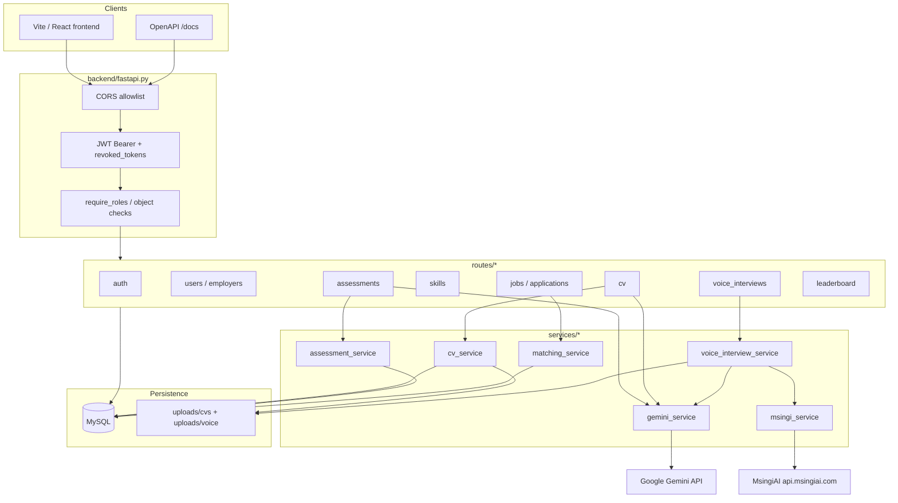
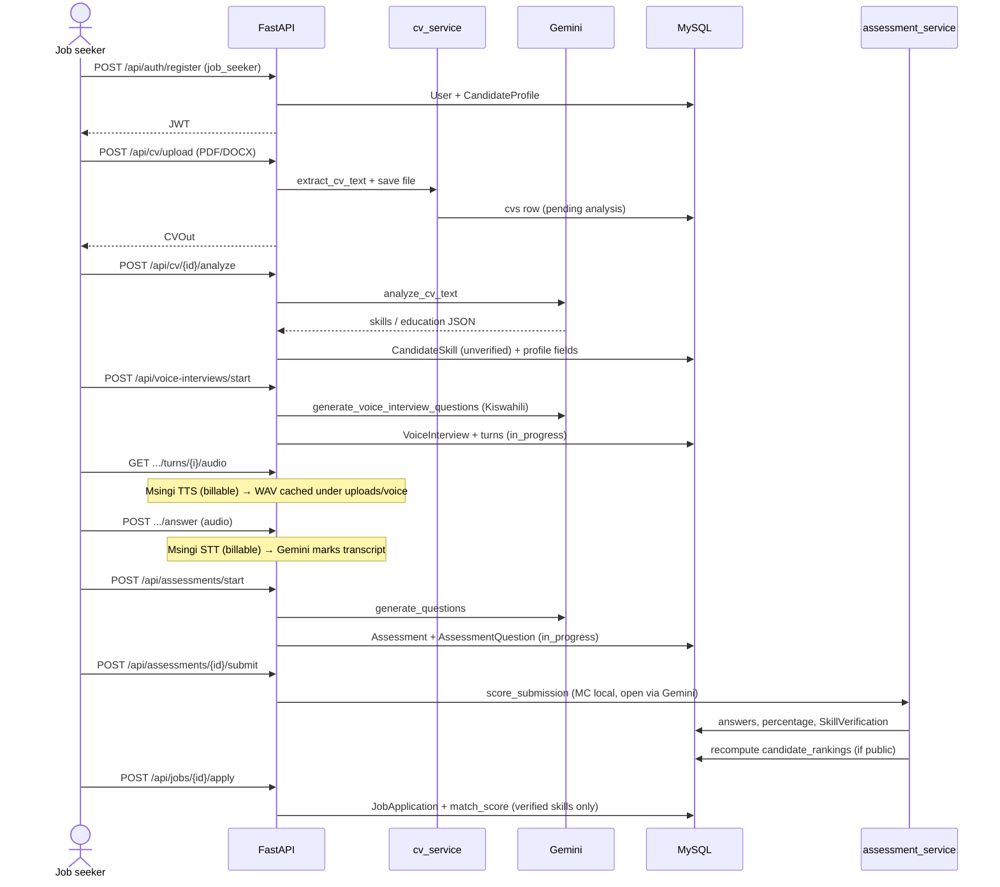
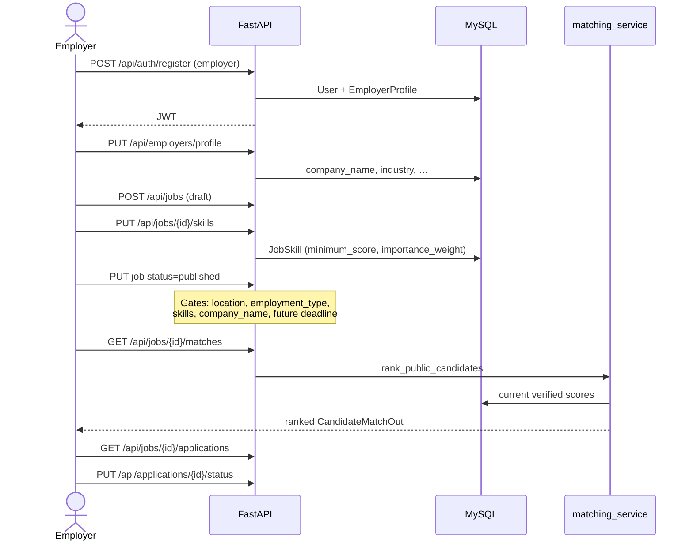
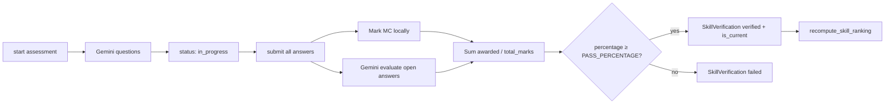
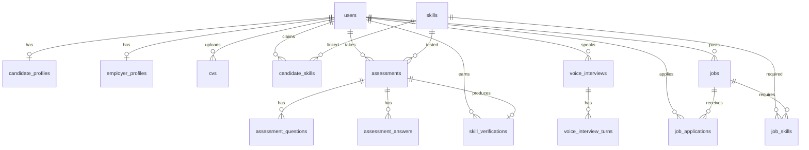

# Thibitisha Skills — Backend flow architecture

This document describes how the FastAPI backend is structured and how the main product flows move through routes, services, MySQL, file storage, and Gemini.

**Entrypoint:** `uvicorn backend.fastapi:app --reload --host 0.0.0.0 --port 8000`

---

## 1. System layers

### Layer responsibilities

| Layer | Location | Responsibility |
|-------|----------|----------------|
| Entrypoint | `fastapi.py` | App factory, CORS, lifespan (uploads, `create_all`, seed) |
| Config | `config.py` | Env-only secrets (`DATABASE_URL`, `JWT_SECRET_KEY`) |
| Auth | `auth.py`, `dependencies.py` | bcrypt, JWT, revocation, RBAC |
| Routes | `routes/` | HTTP + authz only |
| Services | `services/` | Domain logic, AI, scoring, matching |
| Models | `models.py` | SQLAlchemy schema |
| Schemas | `schema.py` | Pydantic request/response |
| Migrations | `alembic/` | Schema versioning |

---

## 2. Job seeker flow

### Seeker stages (summary)

1. **Auth** — register/login → JWT  
2. **CV** — upload PDF/DOCX → extract text  
3. **Analyze** — Gemini extracts claimed skills (unverified)  
4. **Voice interview** — Kiswahili spoken Q&A via [MsingiAI](https://platform.msingiai.com/docs) after CV; Gemini writes questions and scores transcripts  
5. **Assess** — skill must be on profile; daily cap; AI questions  
6. **Verify** — pass mark → `skill_verifications.is_current`  
7. **Apply** — match score from verified scores only  

---

## 3. Employer flow

### Match formula

For job skills with weight \(w_i\) and minimum \(m_i\), and candidate verified score \(s_i\):

- If \(s_i \ge m_i\): earn \(w_i \times (s_i / 100)\)
- Else: requirement not met  
- \(\text{match\%} = \dfrac{\sum earned}{\sum w_i} \times 100\)

Unverified or missing skills count as missing.

---

## 4. Assessment & verification internals

Marks by type: multiple_choice = 1, text = 2, practical = 3.  
Verification level from score bands, **capped by** assessment `difficulty_level`.

---

## 5. Data model (core relationships)

---

## 6. Route map

| Module | Prefix | Primary actors |
|--------|--------|----------------|
| `routes/auth.py` | `/api/auth` | All |
| `routes/users.py` | `/api/users`, `/api/candidates`, `/api/admin` | Seeker, employer, admin |
| `routes/employers.py` | `/api/employers` | Employer |
| `routes/cv.py` | `/api/cv` | Seeker |
| `routes/skills.py` | `/api/skills` | Public + seeker + admin |
| `routes/assessments.py` | `/api/assessments`, `/api/verifications` | Seeker |
| `routes/voice_interviews.py` | `/api/voice-interviews` | Seeker (Msingi TTS/STT) |
| `routes/jobs.py` | `/api/jobs` | Public + employer |
| `routes/applications.py` | `/api/jobs/{id}/apply`, `/api/applications` | Seeker + employer |
| `routes/leaderboard.py` | `/api/leaderboard` | Public |

---

## 7. Cross-cutting concerns

- **Secrets:** only from `backend/.env` — no weak JWT/DB defaults in code  
- **AuthZ:** JWT → revocation check → active user → role → ownership  
- **Uploads:** PDF + DOCX; magic-byte detection; size cap; stored under `uploads/cvs`; voice under `uploads/voice`  
- **MsingiAI:** server-side `MSINGI_API_KEY` only; TTS/STT via `https://api.msingiai.com` ([docs](https://platform.msingiai.com/docs)); billable on audio endpoints  
- **AI safety:** untrusted CV/answers fenced; JSON schema-validated  
- **Health:** `GET /health` reports DB reachability and whether Gemini is configured  

---

## 8. Related docs

- [backend/README.md](./README.md) — setup, migrations, tests  
- [FRONTEND_INTEGRATION_GUIDE.md](../FRONTEND_INTEGRATION_GUIDE.md) — endpoint contract for the UI  

### Interactive view in Cursor

An interactive version of this architecture (tabs + flow diagrams) is available as a Cursor Canvas beside chat:

`~/.cursor/projects/home-saint-thibitishaSkillz/canvases/backend-flow-architecture.canvas.tsx`

That canvas is a Cursor IDE surface (not committed as a runnable app inside this repo). **This `ARCHITECTURE.md` file is the source of truth in the repository** for GitHub, pitch decks, and teammates.  
